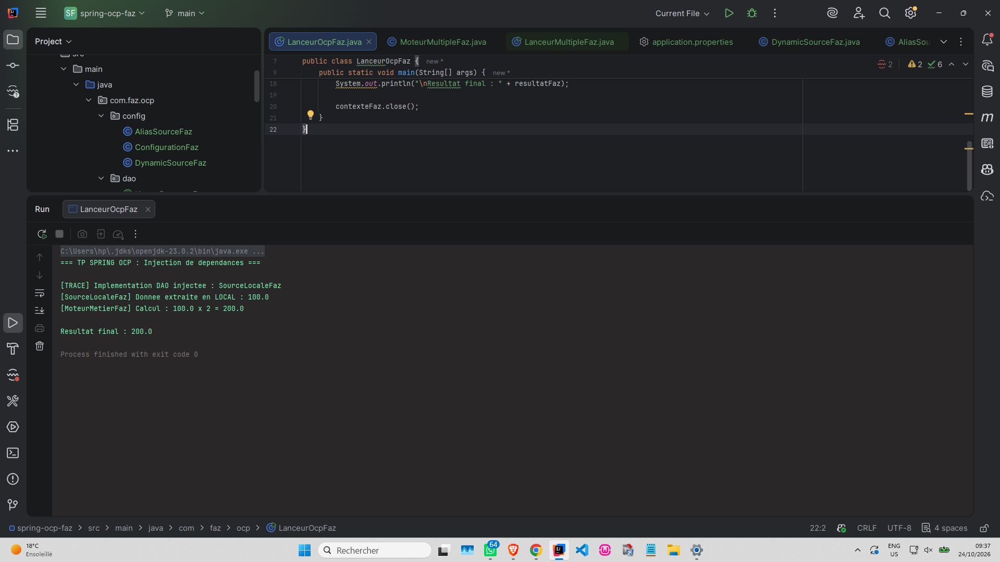
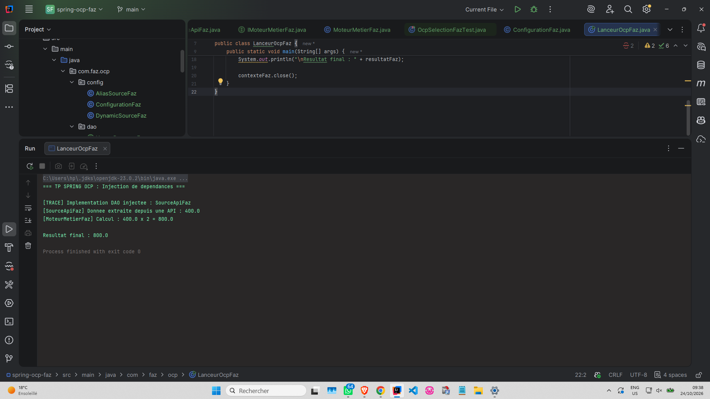
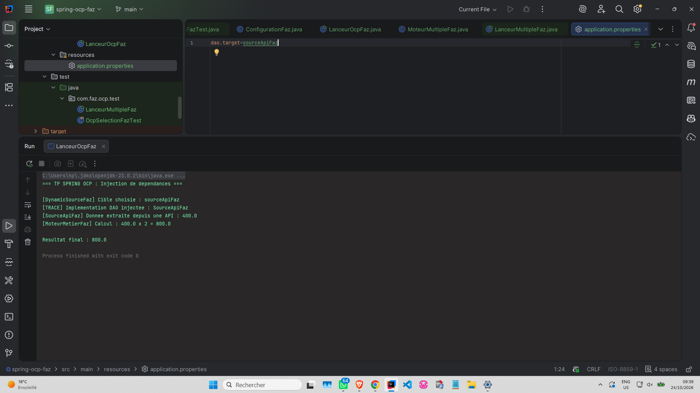
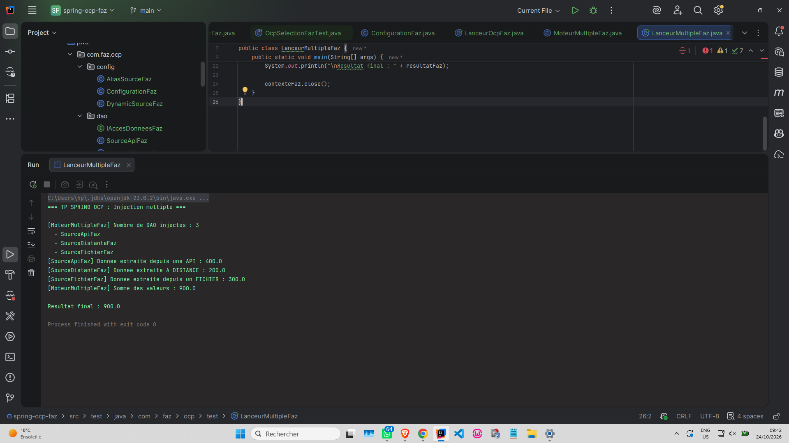

### 1. Stratégie @Primary
*Source locale par défaut.*

---

### 2. Stratégie Alias @Bean
*Pointe vers SourceApiFaz.*

---

### 3. Stratégie Propriétés externes
*Choix via application.properties.*

---

### 4. Injection multiple
*Spring injecte les 3 DAO dans MoteurMultipleFaz.*

